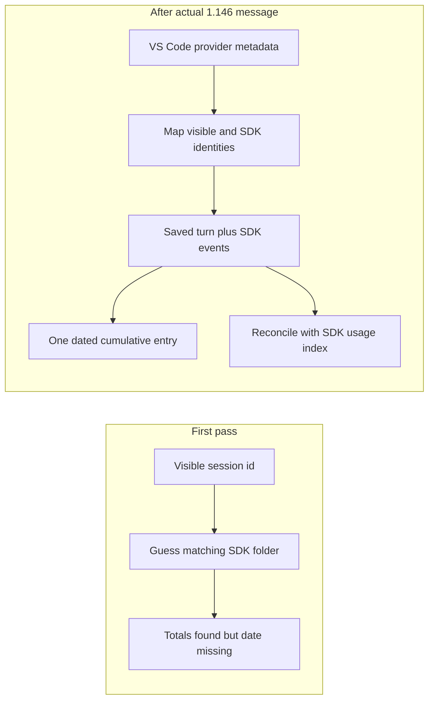
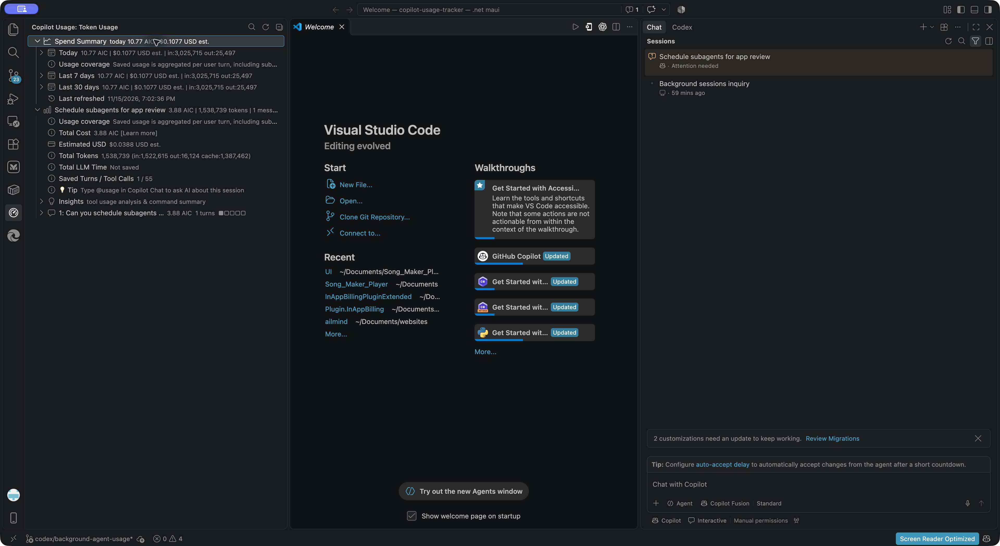
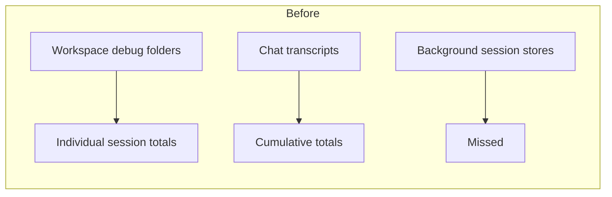
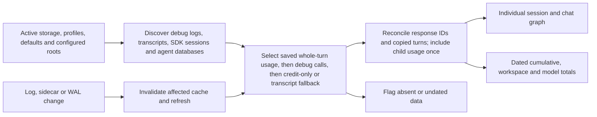
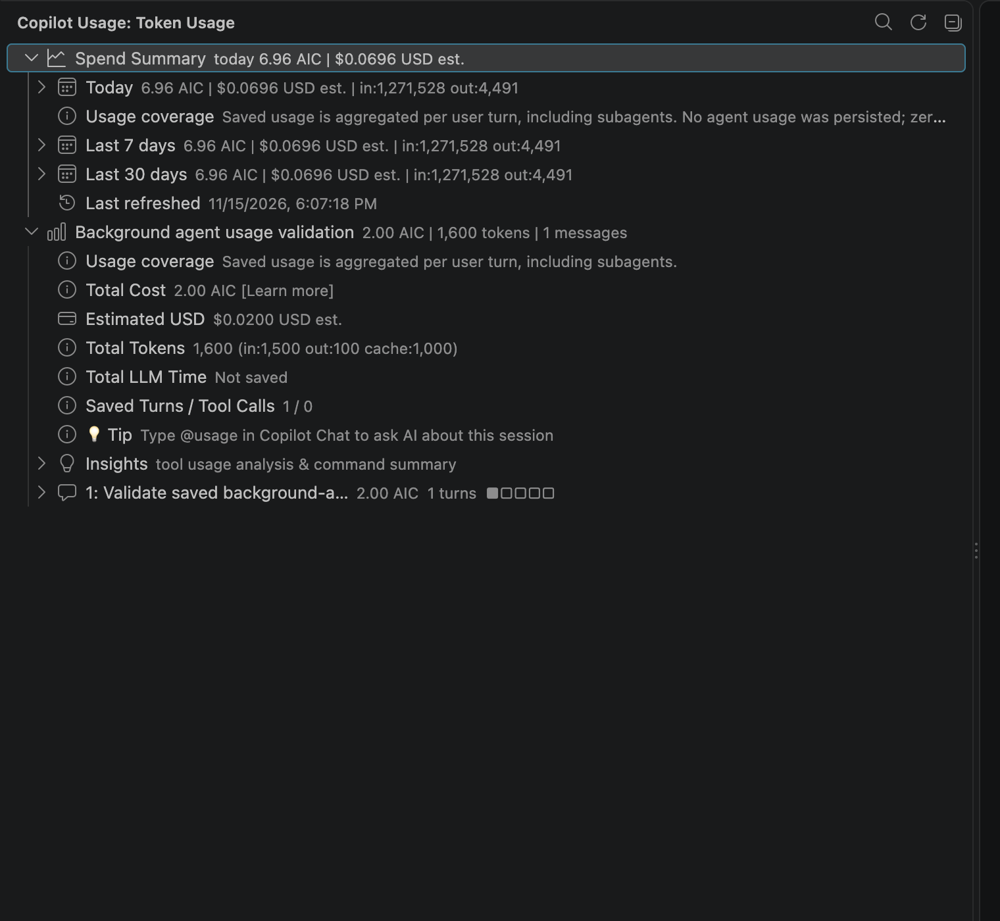

# Background-agent usage review

Changes build on extension `main` at `8bf6b7d`. Reference: Microsoft VS Code `main` at `776b518e720e780fb590f29872473f90bda9e079`; initial native validation used VS Code 1.142.0. The post-update audit below uses the exact installed VS Code 1.146.0 commit `69047191fc427f2f92828279aae1d90d8eeda7ab`, with Copilot 0.74.0 and SDK 1.0.30-preview.0, on 15 November 2026.

## Post-update verification: VS Code 1.146.0

The user's real post-update message revealed two gaps in the first pass: the visible VS Code session id and SDK session id differ, and this SDK persists `session.usage_record` events. Both are now handled. Provider metadata maps the ids in both directions, dependencies follow the mapped SDK log, and SDK call records are deduplicated by their accounting identity. Checkpoints are cumulative snapshots, not extra calls to add.

Native validation on 1.146.0 reconciled **29 model calls: 4 parent calls and 25 subagent calls**. The child calls are inside the parent's SDK log; a separate directory per agent is not required. The following three sources agree exactly:

| Source | Credits | Input | Output | Cached input |
| --- | ---: | ---: | ---: | ---: |
| VS Code saved inclusive turn usage | 3.882857 | 1,522,615 | 16,124 | 1,387,462 |
| SDK durable call records | 3.882857 | 1,522,615 | 16,124 | 1,387,462 |
| SDK `assistant_usage_events` index | 3.882857 | 1,522,615 | 16,124 | 1,387,462 |

The SDK index and log contain 29 measured call records each, with no unmatched usage fingerprints. Their event ids belong to different domains; comparison uses multisets of session, agent, model, and measured token/credit values rather than equating those ids. Both the SDK path and the visible-session database resolve to one dated turn in cumulative spend. Native graph-tool reads passed too.

The inventory found 32 agent stores: two are aliases for the populated SDK session, 30 contain no saved usage, and none were unreadable inside VS Code. Empty stores do not establish whether historical work was free, unused, or never persisted.

Run `npm run audit:coverage` to repeat the local reconciliation. Use `-- --user-data-dir /path/to/data` or `-- --search-root /path/to/store` for extra stores. The report exposes unmatched indexed/logged calls, missing event files, unreadable stores, undated turns, and newly encountered usage event types. A passing local reconciliation is evidence for that snapshot, not certification of every agent/backend.

| Execution path | Evidence / coverage |
| --- | --- |
| Legacy Local harness in the extension host | Source reviewed; original local session reconciled |
| Copilot Agent Host from Chat, Agents, or detached chat windows | Same backend/store family; exact 1.146 source reviewed and real message verified |
| Copilot Fusion / nested subagents | Real 25-child-call reconciliation; parent inclusive totals counted once |
| Legacy extension-host Copilot CLI and standalone CLI | SDK metadata/event readers and fixtures; standalone CLI execution not tested live |
| Compaction and resume/checkpoints | Owning source and fixtures reviewed; no native compaction run in this audit |
| Claude and Codex Agent Host providers | Separate providers in the actual bootstrap; shared saved-usage schema only, provider-specific history/date coverage not certified |
| SSH, WSL, containers, tunnels, shared/remote Agent Hosts | Only stores visible to this extension host can be read; inaccessible hosts not certified |
| Cloud-only sessions | Not covered by this local filesystem scanner |
| SDK index rows whose event logs were deleted | Audit detects these; index is a verification source, not currently a production billing fallback |

Exact-build sources: [provider registration](https://github.com/microsoft/vscode/blob/69047191fc427f2f92828279aae1d90d8eeda7ab/src/vs/platform/agentHost/node/agentHostMain.ts#L194), [separate chat/SDK backing identities](https://github.com/microsoft/vscode/blob/69047191fc427f2f92828279aae1d90d8eeda7ab/src/vs/platform/agentHost/node/copilot/copilotAgent.ts#L5980), [chat storage identity](https://github.com/microsoft/vscode/blob/69047191fc427f2f92828279aae1d90d8eeda7ab/src/vs/platform/agentHost/node/sessionDataService.ts#L110), [compaction billing](https://github.com/microsoft/vscode/blob/69047191fc427f2f92828279aae1d90d8eeda7ab/src/vs/platform/agentHost/node/copilot/copilotAgentSession.ts#L11653). Also checked the [SDK's durable-event documentation](https://github.com/github/copilot-sdk/blob/main/docs/features/streaming-events.md).

## Installed release 0.8.0 — normal VS Code

Installed the packaged release into both the default profile and the `.net maui` profile used by the normal VS Code window, then reloaded that window. The old profile was still running 0.7.0 after the default-profile install; explicit profile installation resolved it.

The normal usage view now finds **“Can you schedule subagents to review this app then run it”**, with **3.882857 AIC** (displayed as 3.88), **1,522,615 input**, **16,124 output**, and **1,387,462 cached input tokens**. Total tokens are **1,538,739**. The saved turn includes **4 parent and 25 subagent model calls**; the UI correctly labels its one saved turn rather than presenting it as one model call. Today, 7 days and 30 days show **10.77 AIC** across three measured local sessions.

A fresh post-install audit reconciles all 29 calls against saved turn usage, SDK event usage, and the SDK index: no unmatched calls or missing event files. There are now 36 local agent stores, 34 without saved usage and zero unreadable stores; the inventory changed when VS Code reloaded. The coverage limits above still apply.

Package: `release/github-copilot-chat-usage-0.8.0.vsix` (25 files, 102.46 KB). SHA-256: `b566a29385d775a7815d612fefb2fa71993b784b1bd7a9b99cd263098795b0b5`. The package excludes development source, tests, review documents and screenshots. All 57 tests passed before packaging; `git diff --check` also passed. Installed runtime files match the packaged files byte for byte.

Uploaded through the **AIlone** Chrome profile to the existing **AIlmind** publisher and existing extension listing. The Marketplace accepted version **0.8.0** for verification; no new account or listing was created.

## Findings and measured result

The cumulative scanner used transcripts while the individual view used debug logs. These are different measurements: a transcript's `promptTokens` can be the latest context window, and its displayed credit amount can be rounded. Background agents also persist usage outside workspace debug folders.

One existing local session reconciles as follows; no test fixtures are included in this comparison:

| Metric | Previous cumulative scan | Updated cumulative scan / individual session |
| --- | ---: | ---: |
| AI credits | 4.9 | 4.9598855 |
| Input tokens | 322,879 | 1,270,028 |
| Output tokens | 4,391 | 4,391 |
| Cached input tokens | Not aggregated | 968,253 |

Cached tokens are a subset of input. Total tokens = input + output; fresh input = input − cached input. Credits use recorded nano-AIU, not token-price estimates.

## Before and after

## What changed

- Discovery covers workspace and global debug folders, empty-window transcripts, profiles, active custom/portable data paths, remote-server data roots, `COPILOT_HOME/session-state`, and `agentSessionData`. Configured roots remain supported. Folder casing and aliases are normalized.
- SQLite opens read-only. `turn_usage` supplies inclusive user-turn billing and `_meta.turnTokenTotals`; context gauges and direct-child totals are not added again. Legacy metadata and shutdown metrics are fallbacks.
- Debug model calls retain their individual values even when they share a response ID. Merged terminal continuations retain separate billing identities. Transcript replacements, truncations, deletions, and forks reconcile correctly.
- Both the current view and cumulative spend watch child logs, sidecars, and SQLite WAL changes. Explicit chat graph requests read fresh data. Debug parsing reuses normalized entries and reads appended bytes; central scan caches include dependency signatures.

On the local 29-source-file dataset: discovery **1.9 ms**, first full scan **30.4 ms**, cached scan **2.0 ms**. These are one-machine measurements, not a performance guarantee.

## Validation and screenshots

`npm test`: **57 passing tests** (28 existing parser/graph cases and 29 source/reconciliation cases). Native VS Code checks passed activation, automatic background-session selection, picker selection, graph-tool output, and fresh explicit graph reads. A WAL-only update changed the selected session from **1.50 → 2.00 AIC** and **1,200 → 1,500 input tokens**, and cumulative spend refreshed automatically.

Screenshots use a synthetic background fixture alongside existing local foreground totals; the displayed cumulative amount therefore includes the fixture.

| Change | Evidence |
| --- | --- |
| Background sessions appear in the picker with their store path | [Picker](validation/session-picker.png) |
| Saved turn totals and data coverage are shown; unsaved duration is labeled | [Individual session](validation/background-session.png) |
| A WAL-only change refreshes the selected session | [Live update](validation/live-background-update.png) |
| The same usage contributes once to cumulative periods | [Cumulative spend](validation/cumulative-spend.png) |

## Accuracy limits

At the initial 1.142 snapshot, all 28 existing local agent databases had empty usage tables. The populated post-update message is covered above. Their historical usage cannot be reconstructed from those databases. Missing usage is explained in the view and graph; a displayed zero does not prove free usage. Background persistence was validated with fixtures matching the owning VS Code schema and a native WAL update.

Without a matching SDK event timestamp, saved usage remains available in the individual session but is excluded from dated periods. Session-wide backend charges can include out-of-turn work and therefore differ from dated turn sums; that difference is flagged. Saved agent aggregates are user turns, not a count of individual model calls. Background workspaces without a reliable mapping are grouped under “Background agents.” Cloud-only or inaccessible remote files are outside this local scanner. Log retention and private schema changes still limit coverage.

## Owning sources

- [Workspace/global debug-log routing](https://github.com/microsoft/vscode/blob/776b518e720e780fb590f29872473f90bda9e079/extensions/copilot/src/extension/chat/vscode-node/chatDebugFileLoggerService.ts#L186)
- [Agent session database location](https://github.com/microsoft/vscode/blob/776b518e720e780fb590f29872473f90bda9e079/src/vs/platform/agentHost/node/sessionDataService.ts#L56)
- [Ephemeral SDK usage, persisted turn usage, and inclusive child accounting](https://github.com/microsoft/vscode/blob/776b518e720e780fb590f29872473f90bda9e079/src/vs/platform/agentHost/node/chatContributions/persistedTurnUsage/persistedTurnUsageContribution.ts#L43)
- [Context gauges versus whole-turn token totals and session credits](https://github.com/microsoft/vscode/blob/776b518e720e780fb590f29872473f90bda9e079/src/vs/platform/agentHost/common/meta/vscode/agentUsageMeta.ts#L108)
