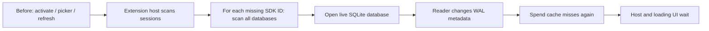
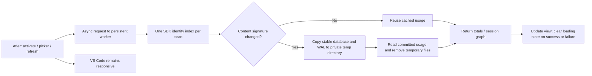
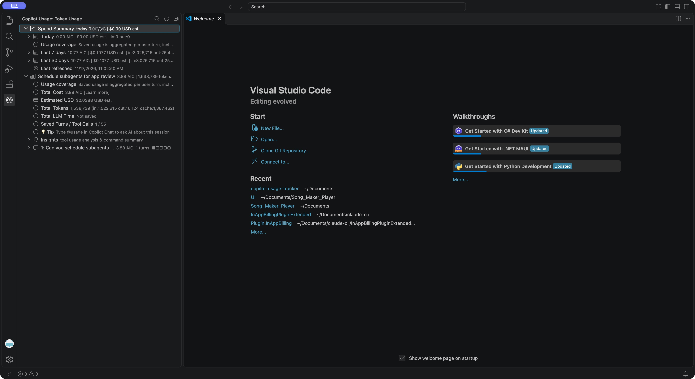

# 0.8.1 hang fix

The reported lookup repeatedly scanned every agent database for sessions without an SDK ID. The 1,024-entry identity cache also discarded entries while walking larger histories. Spend signatures included ctime, which SQLite readers could change on live WAL files. All this work ran synchronously in the extension host.

`scanner.ts` owns discovery and parsing; `usageWorker.ts` runs it outside the extension host. `usageClient.ts` deduplicates concurrent requests and rejects pending calls on failure/disposal. UI refreshes coalesce while a scan is running; stale session selections cannot replace a newer selection. The picker and chat tools use the same worker. Parent/child accounting and source precedence remain unchanged. Paired SDK/VS Code stores are scanned once.

SQLite readers operate on a private copy of both the main database and WAL. A source change during copying retries up to three times; failed snapshots are not cached as zero usage. Main/WAL content signatures use inode, size and nanosecond modification time, excluding ctime and shared-memory bookkeeping. This preserves uncheckpointed committed usage. SQLite's [WAL documentation](https://www.sqlite.org/wal.html) explains why read-only connections can still require shared-memory files.

## Validation

- 62 automated checks: 28 parser/graph, 29 discovery/accounting, 5 performance/lifecycle regressions.
- Synthetic 2,204-store history with only 261 SDK identities: one folder scan and one identity read per database; a second pass makes zero database copies. Initial index ~0.98 s, warm index ~0.10 s, cold spend ~2.36 s, warm spend ~0.21 s. These fixtures validate algorithmic scaling, not the exact Windows workload in the photos.
- A separate synthetic 492 MiB event log preserves exact totals and reuses the warm cache; its cold scan took ~282 ms and warm scan <1 ms. Host heartbeat maximum gap <6 ms. Run `node scripts/benchmark-usage.cjs` after compilation to repeat.
- Source DB, WAL and SHM bytes and timestamps remain unchanged by reads. WAL-only writes invalidate the cache; checkpoints do not duplicate usage. A write during copying is retried. Transient read failures are retried on the next scan.
- Native VS Code 1.146.0 / Node 24.22.1: activation ~21 ms; autoload, search, explicit graph loading, and live selected-session WAL refresh passed. Host heartbeat maximum gap ~12 ms.
- The user's earlier background message still reconciles saved usage, SDK events and the SDK index: 29 calls (25 child calls), 3.882857 AIC, 1,522,615 input, 16,124 output, and 1,387,462 cached tokens. No unmatched indexed/logged calls in accessible local stores.

The photographed Windows dataset is not available on this Mac. Remote/cloud stores inaccessible to this host and unsaved usage remain outside verified coverage.

## Installed package

Installed 0.8.1 into normal VS Code and the `.net maui` profile. The normal Usage panel loads the real background message and cumulative history; the 34-result picker loads, selects a session and returns to its idle state.

VSIX: `release/github-copilot-chat-usage-0.8.1.vsix` (32 files, 110,918 bytes). SHA-256: `bbf386519e97afb2fca889553e1c74612abcb3216f2d92e85669334028454d5b`. Packaged runtime files match the repository build, including the worker entry point. There are no runtime npm dependencies; the package excludes development tools, tests and validation artifacts.

Submitted on 17 November 2026 through the **AIlone** Chrome profile, using **Update** on the existing **AIlmind / GitHub Copilot Chat Usage** listing. The Marketplace accepted the tested VSIX and shows **Verifying 0.8.1**; 0.8.0 remains the displayed released version while verification runs.
