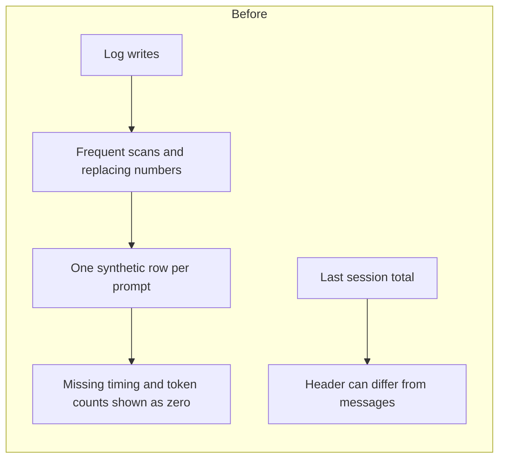
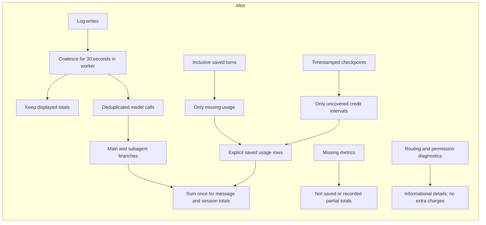
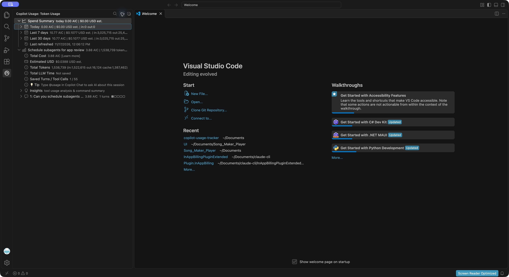
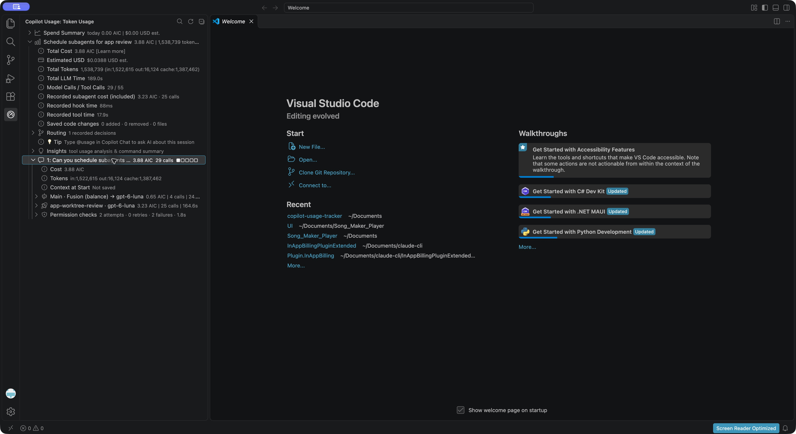
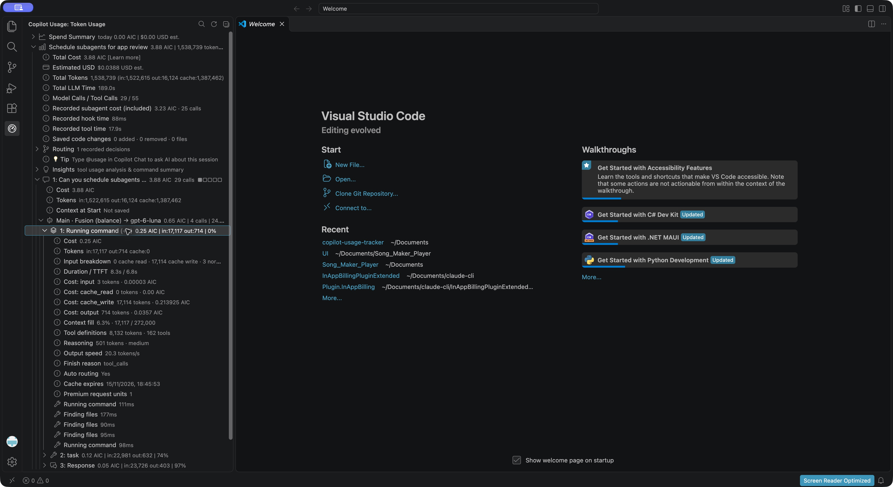

# Copilot Usage 0.8.3 review

Built and checked against VS Code **1.146.0** (`69047191fc427f2f92828279aae1d90d8eeda7ab`) on 17 November 2026. Installed in normal VS Code and the existing `.net maui` profile.

| Change | Verified behavior |
|---|---|
| Refresh | At most once every 30 seconds during log changes. Existing numbers remain visible with one summary spinner; manual Refresh is immediate. Long coverage explanations moved to the Marketplace README. |
| Calls and agents | Individual model calls retain timing, TTFT and tool links. Main and named subagents have separate branches; saved aggregate remainders stay explicit. |
| Accounting | Header equals the sum of message rows. Checkpoints contribute only previously unaccounted credits; stale shutdown totals cannot erase later calls. |
| Dates | A checkpoint interval counts only inside a period containing the entire interval. Missing dates stay undated. A gap across midnight is not presented as exact daily usage. |
| Missing tokens | Credit-only records show Not saved; partial totals say recorded. Recorded zero counts remain zero, and costs stay unchanged. |
| Diagnostics | Routing reasons, candidates, scores and latency; permission attempts, failures and explicit retries; normal input/cache reads/cache writes/output costs; reasoning, context fill, tool overhead, cache expiry, compactions, recorded hook/tool time and saved code changes. |
| Fusion | Recorded charges remain unchanged. Savings comparisons require matching recorded model/context rates. Non-Auto child usage is identified without assuming a universal discount. |
| Discovery and caches | Empty agent stores are filtered; titles fall back to the first prompt. Unchanged identity metadata is reused across windows. Spend-cache writes merge under a lock. Busy databases retain their last readable totals. |

## Screenshots from normal VS Code

The final agent-branch screenshot is from 0.8.3. The before/detail captures show the 0.8.1 to 0.8.2 changes retained in this release.

**Before:** one saved turn and missing timing.

**After:** the same session has 4 main-agent calls and 25 subagent calls, costing **3.882857 AIC** in total. The two permission failures are diagnostics, not extra charges.

**Per-call detail:** the first call shows **8.272 s** duration and **6.810 s** TTFT; **17,114 cache-write tokens**, **3 normal-input tokens**, and exact token charges. The normal-input charge is **0.00003 AIC**, not zero.

## Validation

- **93 automated tests passed**: 28 parser tests and 65 source, performance, refresh and diagnostic tests.
- The 2,204-store fixture completed its worker listing in about **1.3 s**; the host heartbeat's largest gap was about **6 ms**. A warm spend pass made **zero SQLite copies**. A second process reused persisted identities without copying databases.
- Native VS Code refresh test: automatic update **29.9 s**, manual update **16 ms**, initial loading and retained totals verified.
- Local-history check: **5 sessions**, **56 model calls**, no session/message total mismatches and no duplicate tool links. The selected background session has **29 calls, 25 from a subagent, and 55 tool calls** linked once.
- Tests cover resumed sessions, sparse per-call logs plus saved totals, checkpoints crossing midnight, undated initial checkpoints, reused/interleaved turn IDs, WAL writes, failed reads, concurrent cache writers, missing metrics, rate comparisons, permission traces and empty-session filtering.
- The Windows histories shown in the supplied photographs are not available on this Mac. Their reported failures are covered with representative fixtures; the live checks above use this machine's records.

Source references used: VS Code `agentUsageMeta.ts` (inclusive turn totals), `agentModelPricing.ts` (price units and context tiers), `sessionDatabase.ts` (saved usage), `copilotAgentSession.ts` and actual SDK events.

Archive: `release/github-copilot-chat-usage-0.8.3.vsix` · SHA-256 `4198ea74cc798743bacf4b763804ea6db5e495145c692601ea244a6bfb846559`.

Marketplace: 0.8.2 is published. The 0.8.3 archive is selected in AIlone Chrome; final submission awaits action-time confirmation for the page's reCAPTCHA.
