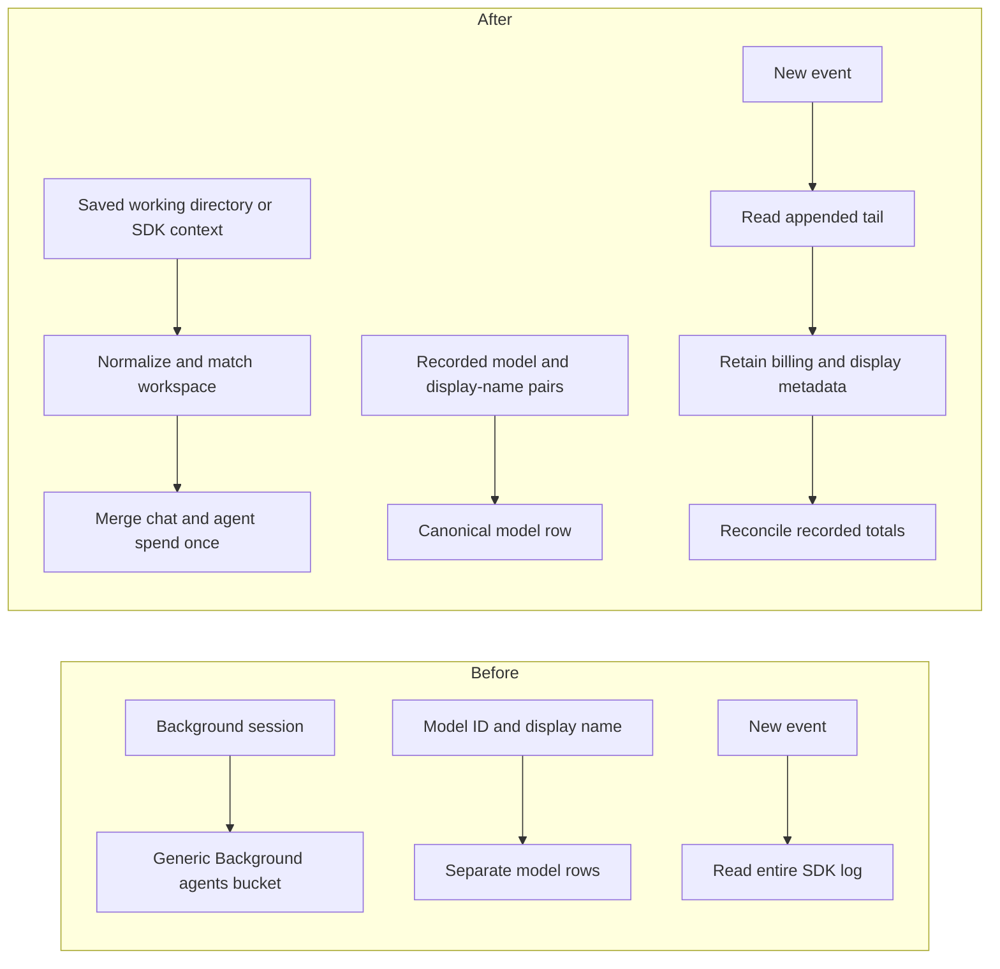
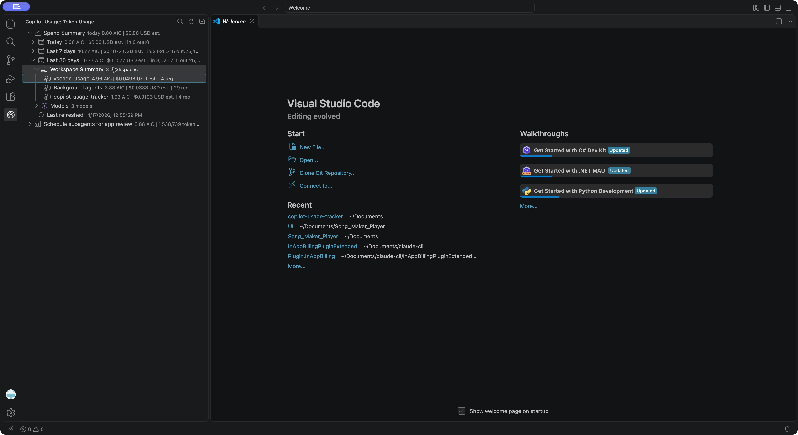
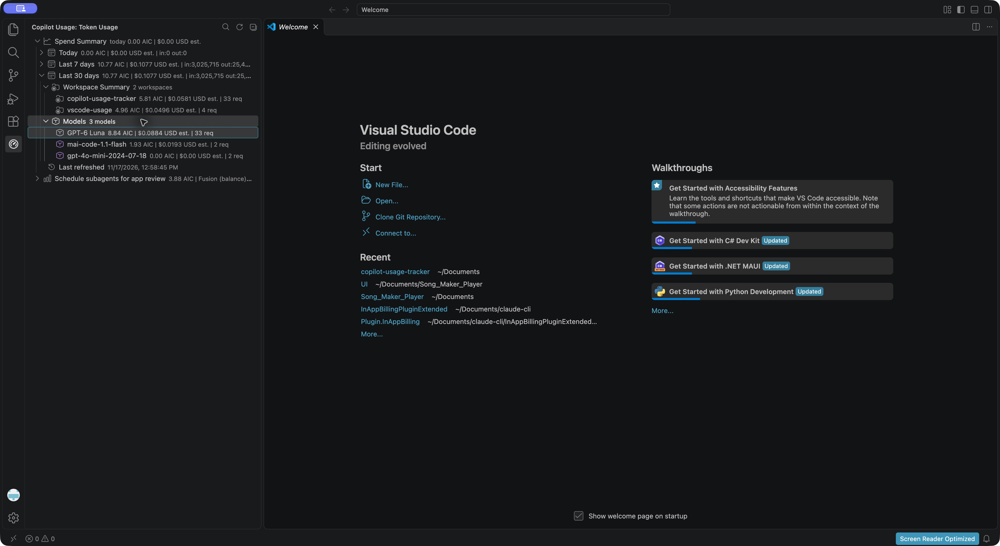
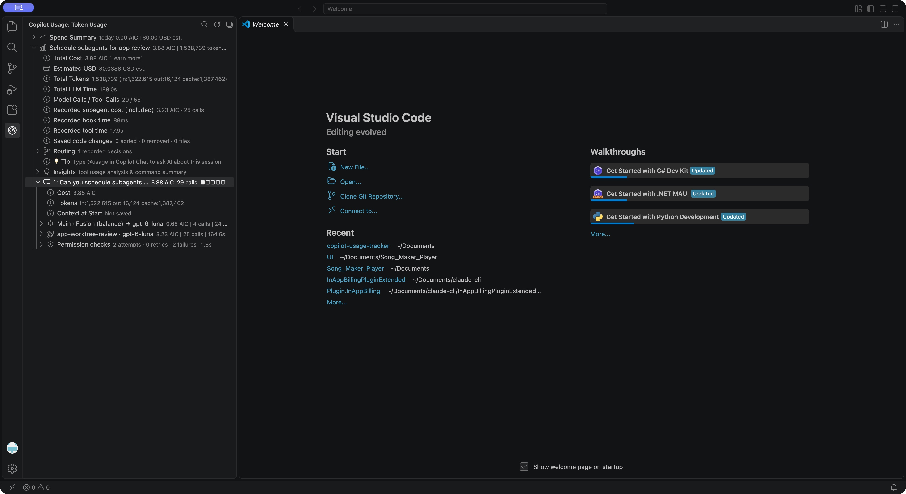
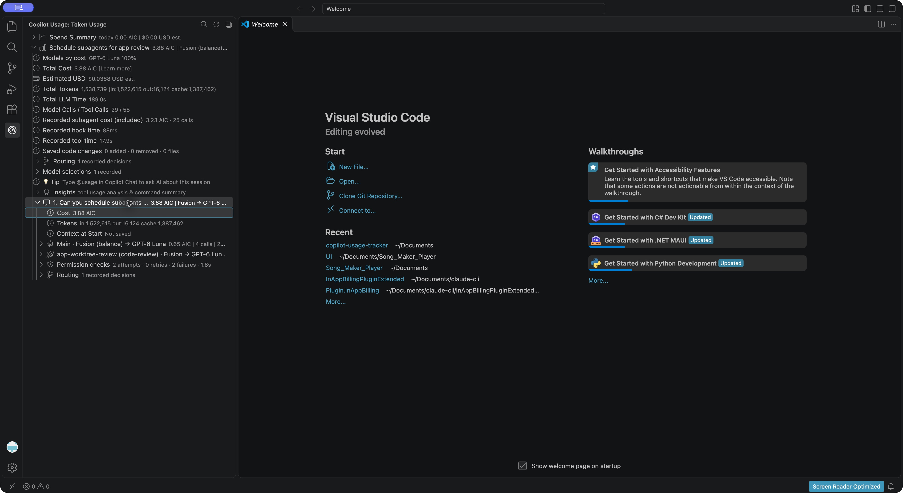

# Copilot Usage 0.8.4 — review

Implemented and installed in normal VS Code and the existing `.net maui` profile on 17 November 2026. The supplied screenshots were treated as guidance against an older 0.8.1 baseline; the existing 0.8.3 fixes were retained.

| Change | Result |
|---|---|
| Workspace attribution | SDK working directories and saved agent workspace metadata resolve to existing VS Code workspace rows. Windows file URIs, drive casing, subfolders and multi-root JSONC files are covered. Sibling clones and worktrees stay separate. |
| Model visibility | Canonical model IDs merge display-name aliases. Session rows show cost mix, prompt rows show model switches and other subagent models, and differing call models/effort remain visible. |
| Routing and selections | Start/resume/model-change and subagent configuration events retain selections. Pre-prompt routing is attached to the first prompt; saved database routing is a fallback. Multiple-model evidence appears under Routing without claiming an unobserved Cascade/Critique mode. |
| Permission diagnostics | Success/completion variants and explicit retry chains show attempts, failures, tokens and timing. They add no extra AIC. Duplicate success aliases are counted once. |
| Large active logs | A bounded metadata cache reads only appended bytes. Partial lines, Unicode boundaries, truncation and replacement are covered. Tool results, attachments and model prompts are excluded from that cache. |
| Accounting | Existing per-call usage, uncovered saved remainders, conservative checkpoint dates, unknown-token labels and 30-second refresh behavior remain. BYOK and context tiers are exposed. |

Before and after workspace attribution in normal VS Code:

The local `copilot-usage-tracker` row now contains **5.809037 AIC**, including the previously separate **3.882857 AIC** background session. `vscode-usage` remains **4.9598855 AIC**. Total: **10.7689225 AIC**, unchanged. The matching model row is displayed as **GPT-6 Luna**.

Model and routing visibility in the same background session:

Validation:

- **107 tests passed**: 28 parser tests plus 79 source, performance, refresh, diagnostics, workspace, model and incremental-reader tests. The final singular-label polish also passed all 13 renderer/refresh tests.
- Live comparison with 0.8.3: **10 session candidates examined, 56 model calls and 99 tool calls**; all compared session costs, token totals, call counts and Today/Week/Month costs were unchanged. Workspace and model sums equal their parent totals.
- Live full-spend scan on this Mac: approximately **43 ms cold / 7 ms warm**. This is a smaller history than the supplied Windows data.
- **2,204-store fixture:** cold identity index 1.06 s; cold spend 2.40 s; warm spend 221 ms with zero SQLite copies. Worker listing 1.08 s; maximum host heartbeat gap **6.4 ms**.
- Incremental-reader test: a small append to a log containing 12,000 large tool-result events reads **under 64 KB**; an unchanged completed log reads **zero bytes**. Cached output contains neither the test tool results nor attachments.
- Native VS Code 1.146.0 visual verification: workspace merge, canonical model rows, session model mix and main/subagent totals. The background session remains **29 model calls / 55 tool calls / 3.882857 AIC**.

Source checks used the local checkout matching VS Code 1.146.0: `copilotAgentSession.ts` (including subagent Auto routing), `agentHostSessionStateMirror.ts` (launch-directory keys), `buildSessionEvents.ts`, `sessionDatabase.ts`, `agentUsageMeta.ts`, and `agentModelPricing.ts`. Historical 0.8.2/0.8.3 validation remains documented separately.

Deliberate limits: no fixed 30% discount or fixed cache TTL; no assumption all subagents are non-Auto; no assignment of an uncertain cross-midnight remainder to an exact day. Zero-credit model rows remain visible because zero alone does not prove a model is universally free. The photographed Windows history was unavailable here; its scenarios were represented by fixtures.

Archive: `release/github-copilot-chat-usage-0.8.4.vsix` (42 files, including the license). SHA-256: `a82c1af43826535b3bb81348501807bb20211f6ff00a4e2868ded69d969214e3`.

Marketplace accepted the 0.8.4 upload through the AIlone Chrome publisher session after user confirmation and the reCAPTCHA check. The publisher page shows **Verifying 0.8.4**; 0.8.2 remains the live version while verification is pending.
