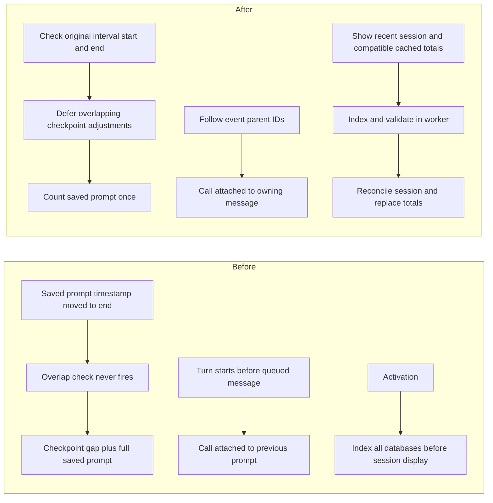
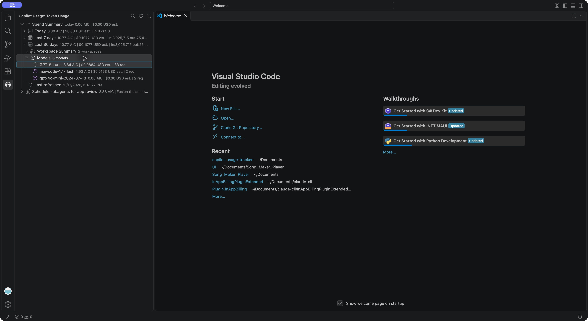
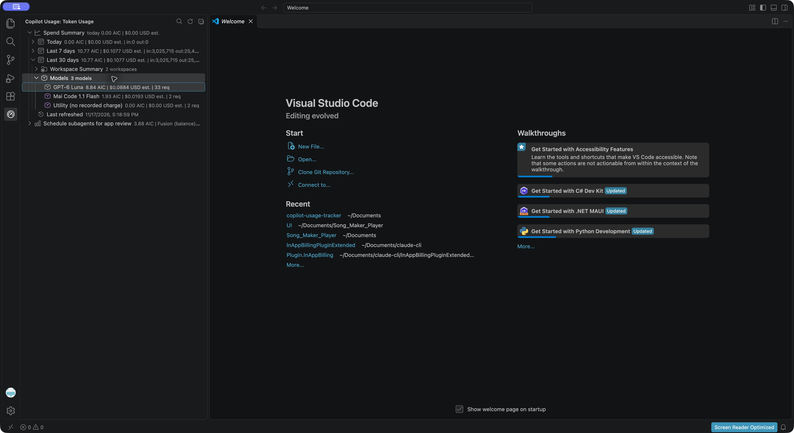

# Copilot Usage 0.8.5 — review

Built and installed in normal VS Code and the existing `.net maui` profile. The photographed findings were checked against 0.8.4 source and reproduced with fixtures; the original Windows history was not available.

| Fix | Verification |
|---|---|
| Long prompts counted twice | A 63-checkpoint fixture returned 14,300 nano-AIU in 0.8.4 instead of the recorded 8,000. It now returns 8,000, and child rows equal the session total. |
| Queued message attributed to the preceding prompt | Event ancestry now takes precedence over an early `turn_start`. The fixture returned 406 instead of 203; it now returns 203 under the queued message. |
| Permission tokens absent | `responseChunk.usage` survives the privacy projection. The fixture's 123 input tokens are now displayed; frustration-classifier calls remain excluded. |
| Confusing model breakdown | Saved mixed-model credits split by remaining token proportions, marked `≈`; the recorded prompt total is unchanged. Unattributed credits are a separate footer, and model names have readable fallbacks. |
| Unwanted rate comparisons | Removed savings/list-price comparisons from the tree and graph. Recorded charges and token-type costs remain. |
| Slow first load | The most recent sessions load before the full identity index. A follow-up reconciles SDK-only first paint with saved inclusive totals after indexing, even while idle. Compatible same-day totals remain visible during validation. |
| Unnecessary work | Skip sources whose dependencies predate the selected period and skip a second usage query for known-empty databases. Normalize Windows cache keys/signatures. Stable rollback-mode databases without sidecars use read-only queries; WAL databases retain the snapshot path. |

Native VS Code model labels, before:

After, with unchanged 30-day spend of **10.7689225 AIC**:

The estimate marker and unattributed footer use the production renderer and are covered by fixture tests; this Mac's current history does not contain those rows. Savings removal and permission tokens are also covered by fixtures rather than presented as live Windows verification.

Validation:

- **119 tests:** 28 parser and 91 Node tests across the final relevant suites. The three new accounting/permission regressions were also run against unmodified 0.8.4 and all failed there.
- Live local comparison: **10 candidates, 56 model calls, 99 tool calls**. Session costs/tokens and Today/Week/Month charges remain unchanged. Workspace sums and model sums plus unattributed credits equal their parents.
- Local full-spend comparison: **26 ms cold / 7 ms warm** on this small Mac history.
- **2,204-store fixture:** cold identity index about **425 ms**, cold spend **920 ms**, warm spend **236 ms**; worker listing **486 ms**, maximum extension-host heartbeat gap **6.4 ms**. Previous 0.8.4 fixture measurements were about 1.06 s, 2.40 s, 221 ms and 1.08 s respectively. These are fixture timings, not a prediction for the photographed Windows machine.
- Fast first-paint fixture reads at most two databases before showing the active session among 300 unrelated stores. Same-day cached paint does not stat source files; yesterday's cached Today total is rejected.
- WAL/rollback source bytes and timestamps remain unchanged in the tests. Changing snapshots retry, rollback journals remain guarded, partial logs and incremental parsing retain existing coverage.
- Native VS Code retains the live session's **3.882857 AIC, 29 calls and 55 tool calls**, and restores its saved title after indexing. The archive contains the license and compiled runtime, with no logs, database files, tests or screenshots.

Limits: the long-prompt fix uses the conservative overlap guard, not speculative checkpoint slicing. Cross-midnight saved remainders still require the entire interval to fit the spend period. Per-model allocation from aggregate tokens is an estimate; no universal rate or discount is inferred. Optional scan-progress text and identity-cache consolidation were not needed for these fixes.

Archive: `release/github-copilot-chat-usage-0.8.5.vsix` (42 files). SHA-256: `d600322b7e47e65ff4c1ec92f80b57c504559f0519ad1d19801cd12c3a6ce388`.

Marketplace: 0.8.4 is confirmed live. The 0.8.5 VSIX is selected in AIlone Chrome; submission is waiting for action-time confirmation of the Marketplace reCAPTCHA.
