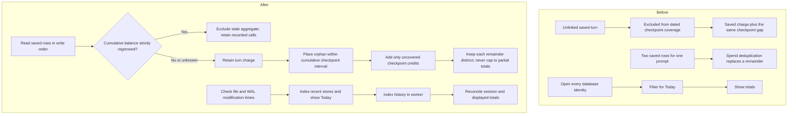
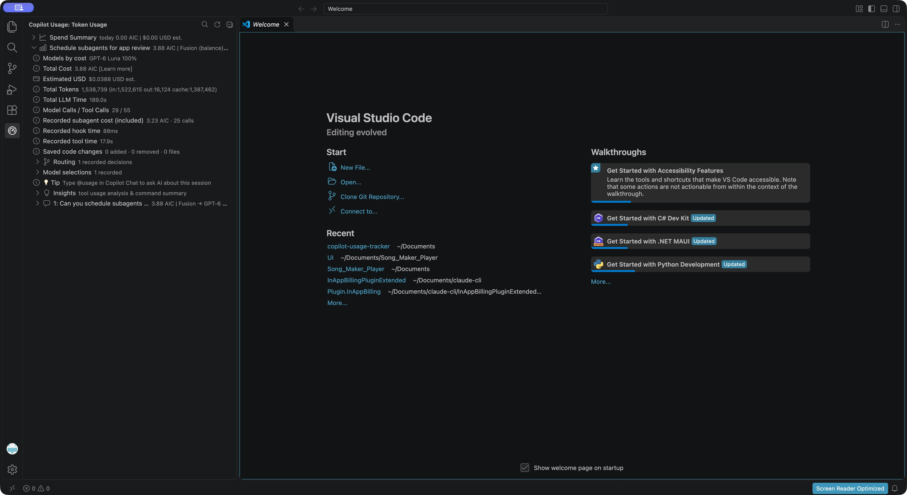

# Copilot Usage 0.8.6 — review

Fixes the remaining photographed accounting and startup issues. The screenshots are guidance from another machine; its Windows logs and `usage-release-kit.zip` were not available here.

| Change | Evidence |
|---|---|
| Orphaned saved turns no longer duplicate checkpoint credits | A fixture that returned 1,894 instead of 1,000 nano-AIU in 0.8.5 now returns 1,000. The row's saved cumulative balance places it within the checkpoint timeline. |
| Replayed saved rows are excluded | A strictly lower cumulative balance than preceding saved rows excludes the stale aggregate. Equal balances, missing balances and partial-zero baselines retain their charges. Independent model calls always remain. |
| Partial totals remain a minimum | A regression fixture retains 2,100 recorded credits against a partial checkpoint of 2,070. No blanket cap is applied. |
| Multiple saved rows for one prompt remain distinct | Spend deduplication uses each saved row's identity, so a later remainder cannot replace an earlier charge. Session totals still equal their children. |
| Today loads before historical indexing | Only recently modified databases and WALs are indexed before Today returns. The worker builds the historical index afterwards, then reconciles both the selected session and Today, including SDK-only first paint. |
| Inactive WAL databases avoid copies | Immutable reads are used only with absent/empty WAL and rollback journal, with before/after content signatures. Active WAL data uses snapshots; concurrent changes, unsupported URI opens and read errors fall back to snapshots. |

Validation:

- **137 tests pass**: 28 parser tests and 109 Node tests. The new suite covers unlinked rows, regressed/equal balances, partial totals, resumed calls, date uncertainty, repeated prompt rows, source deduplication, delayed indexing and SQLite safety. The accounting, repeated-row and cold-start regressions also fail against unmodified 0.8.5.
- **2,225-store fixture, 58 recently changed:** cold Today **1.37 s → 0.13 s** on this Mac; historical databases opened before Today **2,167 → 0**. Deferred history indexing took **0.85 s**; warm Today **86 ms**. These are synthetic measurements, not a promise of Windows timings. Worker heartbeat maximum gap: **5.7 ms**.
- **Local history:** 10 candidates, 56 model calls and 99 tool calls retain their costs and token totals. The month remains **10.7689225 AIC**; model and workspace breakdowns add up.
- Immutable URI reads were exercised in both Node 24.21.0 and VS Code's actual Electron 43.8.6 / Node 24.22.1 runtime. Tests verify no live-file/sidecar changes, active WAL preservation, retry after a concurrent writer, fallback on read error and rollback-journal rejection.
- Archive and installed runtime hashes match the tested build. Installed in normal VS Code and the existing `.net maui` profile.

Source review: VS Code commit `69047191fc427f2f92828279aae1d90d8eeda7ab`, `agentUsageMeta.ts`, `_parentCopilotUsageMeta()` and `sessionDatabase.setTurnUsage()` confirm the separate turn/session balances and `INSERT OR REPLACE` persistence. Immutable opening and its locking caveat are documented by [SQLite](https://www.sqlite.org/uri.html); the implementation validates source signatures and retries rather than assuming a live database cannot change.

Unknown dates remain conservative: a cumulative interval contributes only to periods containing the entire interval; rows without a usable balance remain undated. This Mac does not contain the two photographed failing Windows sessions, so their exact corrected totals still need confirmation on that machine.

Native VS Code after installing and reloading the final build:

Package: `release/github-copilot-chat-usage-0.8.6.vsix` (42 files). SHA-256: `7b30d0772f57c09f24c112ac5e481680a63542c9ecb7427f54655c85c088c7d4`.
